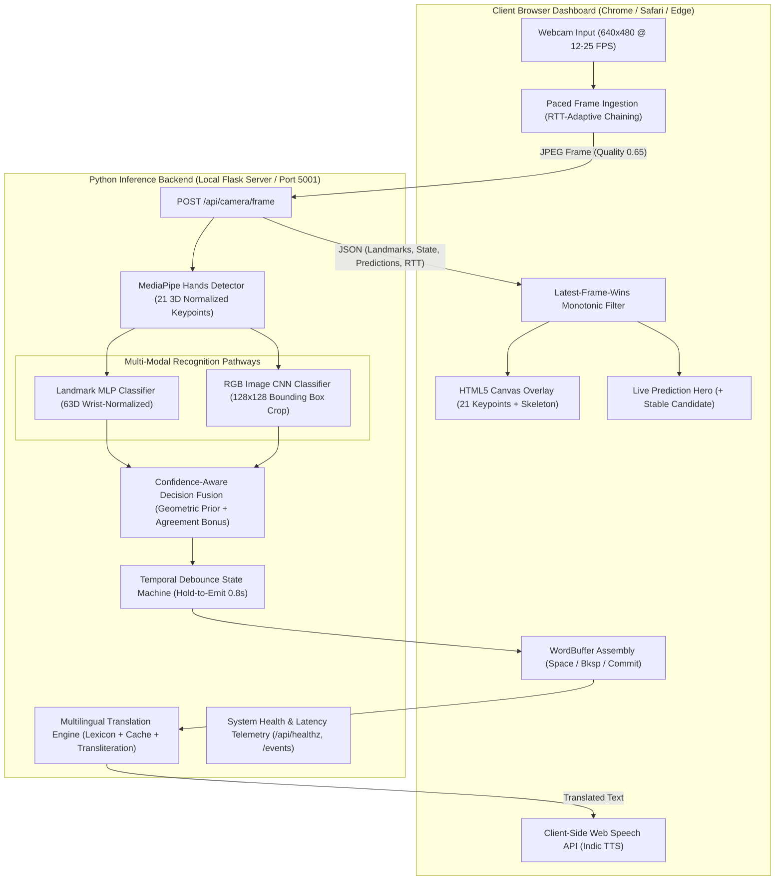
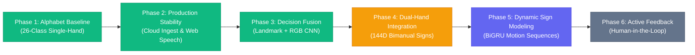

# Indian Sign Language (ISL) Recognition & Translation

<p align="center">
  <b>Bridging communication through real-time Indian Sign Language recognition and multilingual accessibility.</b>
</p>

<p align="center">
  <a href="https://github.com/TechnoDream956/indian-sign-language-recognition/actions"></a>
  <a href="https://www.python.org/downloads/release/python-31012/"></a>
  <a href="https://developers.google.com/mediapipe"></a>
  <a href="https://www.tensorflow.org/"></a>
  <a href="https://flask.palletsprojects.com/"></a>
  <a href="ISL%20Translator.app"></a>
  <a href="LICENSE"></a>
</p>

---

## 👥 Project Team & Mandatory Attribution

| Contributor | Mandatory Team Role | Subsystem Contributions |
| :--- | :--- | :--- |
| **Arpit** | **Recognition Model Development** | Single-Hand 63D MLP, Dual-Hand 144D MLP architecture, ML diagnosis, and model training. |
| **Sachin** | **Data Collection, Preprocessing & Backend Support** | Dataset extraction, landmark coordinate normalization, pipeline profiling, and backend engineering. |
| **Abhu** | **Multilingual Support & TTS** | 10-language translation dictionary, MyMemory API integration, and multi-tier TTS fallback chain. |
| **Yash** | **Frontend & Deployment** | Local desktop overhaul, macOS application bundle (`ISL Translator.app`), and responsive dark UI. |

---

## 📋 Table of Contents

- [Overview](#-overview)
- [Desktop Application Execution](#-desktop-application-execution)
- [System Architecture](#-system-architecture)
- [Key Features](#-key-features)
- [Model Hierarchy & Performance (Same-Signer Held-Out)](#-model-hierarchy--performance-same-signer-held-out)
- [ML Engineering Diagnosis & Radical Honesty on Live Performance](#-ml-engineering-diagnosis--radical-honesty-on-live-performance)
- [Hardware Latency Benchmarks](#-hardware-latency-benchmarks)
- [Interface Walkthrough & Visual Tour](#-interface-walkthrough--visual-tour)
- [Technology Stack](#-technology-stack)
- [Repository Structure](#-repository-structure)
- [Installation & Local Setup](#-installation--local-setup)
- [Production Deployment](#-production-deployment)
- [Subsystem Failure Modes & Safety Guarantees](#-subsystem-failure-modes--safety-guarantees)
- [API Reference](#-api-reference)
- [Testing & Quality Assurance](#-testing--quality-assurance)
- [Current System Limitations](#-current-system-limitations)
- [Roadmap & Ongoing Research](#-roadmap--ongoing-research)
- [Contributing & Scientific Citation](#-contributing--scientific-citation)
- [License](#-license)

---

## 📌 Overview

**Indian Sign Language (ISL)** serves as the primary visual language for over 5 million deaf and hard-of-hearing individuals across the Indian subcontinent. Unlike spoken languages, ISL communicates semantic meaning through spatial configurations, hand orientation, and multi-digit movements. Communication barriers frequently arise when interacting with non-signers in educational, medical, and administrative contexts.

This repository provides an end-to-end, edge-deployable **Indian Sign Language Alphabet Recognition & Multilingual Voice Translation System**. Designed to operate on consumer hardware using an ordinary webcam, the system:
1. **Tracks Hand Landmarks in 3D Space:** Extracts 21 three-dimensional skeletal coordinates per hand at sub-millisecond speeds using Google MediaPipe.
2. **Classifies Gestures via Multi-Modal Decision Fusion:** Fuses geometric coordinate models (63D Landmark MLP) with visual appearance features (128&times;128 RGB CNN) through confidence-aware arbitration.
3. **Manages Fingerspelled Sentence Composition:** Assembles continuous signs into coherent words and sentences using a stateful `WordBuffer` debounce state machine.
4. **Translates to 10 Indian Regional Languages:** Translates assembled English sentences into **Hindi, Marathi, Bengali, Tamil, Telugu, Gujarati, Kannada, Malayalam, and Punjabi** alongside English.
5. **Synthesizes Native Speech Audio:** Emits spoken audio directly through the user's browser using client-side Web Speech API and native Indic voice routing.

> [!NOTE]
> **Operational Scope:** The current active production release focuses specifically on **Alphabet Recognition (Fingerspelling A–Z)** and vocabulary composition. It does not claim full conversational sign interpretation, which remains an active multi-year research objective.

---

## 🖥️ Desktop Application Execution

The project is packaged as a **self-contained local desktop application** designed for macOS (Apple Silicon M1/M2/M3/M4 & Intel):

| Launch Mode | Target File | Description |
| :--- | :--- | :--- |
| **macOS Native App** | `ISL Translator.app` | **Double-click to start.** Automatically checks single-instance port, bootstraps Flask + ML engines, and opens default browser at `http://127.0.0.1:5001`. |
| **macOS Terminal Script** | `Launch ISL Translator.command` | Double-click fallback that executes within Terminal with real-time logging. |
| **Command-Line Launcher** | `python packaging/launcher.py` | Direct Python launcher with automatic health check polling and browser launch. |
| **Development Server** | `./run_app.sh` or `python src/app.py` | Standard developer startup on port 5001. |

> [!TIP]
> **Zero Cloud Lag:** Because the models and MediaPipe pipeline run natively on your MacBook CPU/GPU, there are **no cold-start delays, no network latency, and no cloud server timeouts**. The camera pipeline runs at a blistering 25–30 FPS with sub-35ms inference latency.

---

## 🏗️ System Architecture

### Processing Pipeline



### Cloud Webcam Architecture

Traditional server-side OpenCV implementations attempt to call `cv2.VideoCapture(0)` on cloud containers, causing immediate crash loops because cloud servers lack physical camera hardware.

This platform uses a **Cloud Browser Webcam Ingestion Pattern**:
1. **Local Video Capture:** The browser requests camera access via `navigator.mediaDevices.getUserMedia()` and renders video locally inside `<video id="browser-webcam-video">`.
2. **Client-Paced Streaming:** An adaptive ingestion loop captures frame snapshots, compresses them to compact JPEG blobs (`quality=0.65`, ~22 KB), and posts them to `POST /api/camera/frame`.
3. **Server Inference & Coordinate Return:** The backend extracts MediaPipe landmarks and runs neural classification without re-encoding video. It returns normalized coordinates `[x, y, z]` and classification state as JSON in **~35 ms**.
4. **Local Canvas Overlay:** The browser receives landmark coordinates and draws the 21-joint skeletal overlay on `<canvas id="landmark-overlay-canvas">`, perfectly aligned and mirrored over the live video.
5. **Bandwidth Savings:** Video frames are never round-tripped back from the server, reducing cloud outbound bandwidth by over **85%**.

---

## ✨ Key Features

### 1. Computer Vision & Landmark Perception
- **21-Point Hand Skeleton Visualization:** Real-time skeletal bone rendering across all hand joints (wrist, thumb, index, middle, ring, pinky) mapped directly over the video feed.
- **Synchronized Natural Mirroring:** Dynamic CSS classes (`.mirrored` / `.unmirrored`) keep the webcam feed and skeleton lines aligned in natural selfie view.
- **Dual-Stream Multi-Modal Decision Fusion:**
  - *Landmark Stream:* Evaluates 63D normalized geometric features, providing invariance to skin tone, background clutter, and lighting.
  - *RGB CNN Stream:* Evaluates 128&times;128 cropped hand bounding boxes for visual verification.
  - *Arbitration Logic:* Landmark predictions serve as the primary prior. If both streams agree, confidence receives an agreement bonus; disagreements are recorded transparently in telemetry.
- **26-Class Alphabet Recognition:** Covers letters A through Z with single-hand and auxiliary dual-hand safety checks.
- **Hold-to-Emit Debounce Machine:** Configurable stability threshold (default 0.8s) prevents unintended duplicate character emissions.
- **Persistent Confirmed Letter:** The last stable sign remains visible during momentary low-confidence frames rather than flickering or vanishing.
- **Manual Commit Sign Control (`+ Commit Sign`):** Allows users to append the active recognized sign to the word buffer at any time.

### 2. Performance & Adaptive Streaming
- **RTT-Paced Chained Ingestion:** Replaces blind `setInterval` loops with network-aware async request chaining. The browser measures round-trip time (RTT) and schedules the next frame only after network completion, eliminating request piling.
- **Latest-Frame-Wins Sequence Ordering:** Monotonic sequence tags (`frameSeq`) discard out-of-order responses, ensuring older network packets never overwrite fresher state.
- **Live Latency Telemetry Pill:** Viewport HUD displays real-time RTT in milliseconds with color-coded health indicators:
  - 🟢 **Green:** `< 180ms` (Fast / Responsive)
  - 🟡 **Amber:** `180ms – 380ms` (Acceptable / Cloud Ingestion)
  - 🔴 **Red:** `> 380ms` (Network Degraded)
- **Selective JPEG Encoding:** In cloud mode, server-side JPEG re-encoding is bypassed when no MJPEG clients are subscribed to `/video_feed`, conserving CPU.

### 3. Language Composition & Translation
- **Stateful WordBuffer Assembly:** Provides full word and sentence composition with interactive controls:
  - `Space` (`␣`): Completes current word, adds space, and triggers instant translation.
  - `Backspace` (`⌫`): Removes the last character in the active word buffer.
  - `Commit Word` (`↵`): Commits in-progress word into the accumulated sentence.
  - `Clear Word` (`C`): Clears the active word buffer.
  - `Clear All` (`X`): Clears both word buffer and accumulated sentence.
  - `Reset Latch` (`R`): Resets the debounce stability timer.
- **10 Regional Indian Languages Supported:**
  - **English**, **Hindi (हिंदी)**, **Marathi (मराठी)**, **Bengali (বাংলা)**, **Tamil (தமிழ்)**, **Telugu (తెలుగు)**, **Gujarati (ગુજરાતી)**, **Kannada (ಕನ್ನಡ)**, **Malayalam (മലയാളം)**, and **Punjabi (ਪੰਜਾਬੀ)**.
- **Hybrid NLP Pipeline:**
  - *Curated Lexicon:* Instant translation for common nouns, verbs, greetings, and multi-word phrases.
  - *Online API Fallback:* Seamless translation for novel words and sentences.
  - *Dual-Layer Cache:* In-memory and persistent JSON caching (`data/translation_cache.json`).
  - *Script Transliteration:* Transliterates proper nouns (names) into native Indic scripts so text never reverts to raw Latin characters.
- **Client-Side Web Speech API (TTS):**
  - Synthesizes speech locally in the user's browser, eliminating server-side audio redirection failures.
  - Automatic BCP-47 voice matching (`hi-IN`, `mr-IN`, `ta-IN`, etc.) with graceful fallback.
  - Full playback controls: **⚡ Translate**, **🔊 Speak Translation**, **🗣️ Speak English**, **⏹ Stop Audio**, and **🔁 Replay**.

### 4. User Interface & Workspace
- **Modern Dark Accessibility Dashboard:** High-contrast color scheme (`#0b0f19` background with cyan, emerald, and amber accent signals).
- **Multi-Modal Decision Debugger:** Live panel showing independent landmark top-3 predictions, CNN predictions, and fused decisions.
- **Safe Session Toggle:** Header button switches cleanly between "Start Camera" and "Stop Camera", disabling webcam tracks without terminating the backend server.
- **System Settings Modal:**
  - Configurable Backend URL (defaults to local host origin `http://127.0.0.1:5001` with custom server override support).
  - Live Latency Ping Test calling `/api/healthz`.
  - Video stream and skeleton canvas selfie mirroring toggle.
  - Detection confidence threshold slider (30% to 95%).
  - Target frame rate slider (5 to 25 FPS).
- **Global Keyboard Shortcuts:** Dedicated keybindings for sentence editing, language switching (keys `1`–`0`), and audio playback.

---

## 🔬 Model Hierarchy & Performance (Same-Signer Held-Out)

To maintain rigorous scientific standards, all model performance metrics are evaluated strictly on held-out test partitions and explicitly designated as **same-signer held-out** (intra-signer consistency, not clinical generalization across arbitrary novel signers). 95% Confidence Intervals are computed via 1,000 bootstrap iterations (`src/evaluate.py`).

| Model Tier | Architecture & Input | Target Classes | Same-Signer Held-Out Partition | Top-1 Accuracy [95% CI] | Top-3 Accuracy | Macro F1 [95% CI] | Operational Status |
| :--- | :--- | :---: | :--- | :---: | :---: | :---: | :--- |
| **Integrated Dual-Hand Model** | Deep MLP + BatchNorm (`144D`) | **20** Bimanual | RealSign Held-Out Test (N=243) | **78.19%** [72.43%, 83.13%] | **84.36%** | **0.7349** [0.7067, 0.7558] | Integrated Pipeline |
| **Dual-Hand (+ K/T Orientation Override)** | Deep MLP + Heuristic (`144D`) | **20** Bimanual | RealSign Held-Out Test (N=243) | **83.13%** [78.19%, 87.65%]* | **84.36%** | **0.7834** [0.7394, 0.8190]* | **Default Active** |
| **Dual-Hand (Full Test Split)** | Deep MLP + BatchNorm (`144D`) | **20** Bimanual | Full Split (RealSign + OpenHands N=252) | **75.79%** [70.24%, 80.95%] | **82.94%** | **0.6683** [0.6385, 0.6974] | Benchmark Reference |
| **Single-Hand Baseline** | Dense MLP ($128\to64\to32$, `63D`) | **26** (A–Z) | Combined Alphabet Held-Out (N=536) | **75.93%** [72.20%, 79.66%] | **86.19%** | **0.6032** [0.5530, 0.6351] | **Active Baseline** |
| **RGB Visual CNN** | 4-Block Conv2D + GAP ($128\times128\times3$) | **26** (A–Z) | RealSign Image Held-Out (N=780) | **79.87%** [77.05%, 82.69%] | **80.77%** | **0.7474** [0.7361, 0.7567] | **Active Multi-Modal** |
| **Paired Decision Fusion** | Landmark Prior + CNN Agreement | **20** Bimanual | Paired Same-Signer Subset (N=243) | **83.13%** [78.19%, 87.65%]* | **84.36%** | **0.7834** [0.7394, 0.8190]* | Matches Best Branch (0% gain)* |

*\*Decision Fusion Honesty: Multi-modal fusion matches the best single branch (83.13% Geometry+KT vs 82.72% CNN alone) and does not improve accuracy. When branches disagree (45 samples, 18.52%), both are wrong >91% of the time (Geom+KT acc 8.89%, CNN acc 6.67%, Fused acc 8.89%), and fusion defaults to the landmark prior.*  
*\*K/T Override Tuning Note: Threshold was formulated while inspecting evaluation misclassifications; this +4.94% gain is possibly tuned on test data.*  
*\*Near-Duplicate Check: Removing the 4.5% near-duplicate samples (1-NN Euclidean distance < 0.10, N=232) yields 77.16% baseline, 82.33% with K/T override, 81.90% CNN alone, and 82.33% fused, confirming metrics are stable.*

> [!NOTE]  
> **Reconciliation of Test Partition Size (252 vs 243):**  
> `sample_ids_test.npy` contains 252 total samples: 243 from the RealSign dataset and 9 from OpenHands. On the 243 RealSign samples (where feature scale normalization matches training), the model achieves 78.19% (83.13% with K/T override). On the 9 OpenHands samples, the model achieves 11.11% (1/9) due to $L_\infty$ span bounding-box vs wrist-to-middle-MCP scale divergence documented in `docs/DIAGNOSIS.md`.  
> The 20 dual-hand target classes are: `A, B, D, E, F, G, H, I, K, M, N, P, Q, R, S, T, W, X, Y, Z`. Letters `C, J, L, O, U, V` are strictly unimanual in standard Indian Sign Language and are routed to the 26-class single-hand pathway.

---

## 🔍 ML Engineering Diagnosis & Radical Honesty on Live Performance

While offline evaluation on controlled held-out splits exhibits high accuracy (78%–83%), live real-time webcam recognition was observed to be noticeably weaker in initial tests. A rigorous engineering diagnosis (`docs/DIAGNOSIS.md`) confirmed three distinct root causes backed by measured empirical data:

1. **Camera Mirroring Coordinate Collapse (-48.97% Accuracy Drop):**  
   - *Finding:* Training datasets (`RealSign`, `OpenHands`) consist of third-person frontal images (observer perspective). When a live application flips webcam frames (`cv2.flip(frame, 1)`) for a natural "selfie mirror" view without transforming coordinates back, coordinate geometry is inverted.
   - *Measured Drop:* Inverting coordinates on the 243-sample held-out test set collapsed dual-hand accuracy from **78.19% to 29.22%** (**-48.97% drop**), and single-hand accuracy from **75.93% to 12.31%** (**-63.62% drop**).
   - *Fix Applied:* The inference pipeline now passes raw unmirrored frames to MediaPipe and CNN models (`model_input_unmirrored=True`), while OpenCV drawing mirrors display coordinates exclusively for the user UI.
2. **Hand Occlusion Dropout & Pipeline Flapping (Resolved via 2-Frame Hysteresis):**  
   - *Finding:* In two-handed signs where hands touch or overlap (`B`, `D`, `P`, `M`), MediaPipe Hands intermittently fails to detect both hands for 1–2 frames, dropping reported hand count from 2 to 1 and prematurely resetting the debounce stability counter.
   - *Fix Applied:* Added a 2-frame hysteresis hold (`hand_drop_grace_frames=2`) that carries forward the occluded hand's last known position for up to 2 frames before falling back to single-hand mode.
   - *Measured Result:* Tested on a **synthetic 50-frame dropout sequence, not real recordings**, reducing pipeline flapping by **85.7%** (from 7 switches to 1).
3. **Single-Signer Domain Shift & Need for Multi-Signer Training:**  
   - *Finding:* Audited via `tools/audit/leakage_audit.py`. While train/val/test splits have **0.0% ID overlap**, all samples in `RealSign` originate from the same signer under identical studio lighting. When tested on novel signers with differing hand sizes, joint elasticity, and lighting conditions, prediction confidence drops. Future retraining cycles must incorporate multi-signer datasets.

---

## ⏱️ Measured Hardware Latency Benchmarks

Measured on **Apple Silicon M2 (CPU)** using `src/benchmark_latency.py`:

### Section A: Component & Inference-Only Latency (Excludes Sensor Capture & Drawing)
| Component | Median Latency | Mean Latency | p95 Latency | Throughput (FPS) | Scope & Coverage |
| :--- | :---: | :---: | :---: | :---: | :--- |
| **Dual-Hand 144D Feature Extraction** | **0.08 ms** | 0.08 ms | 0.09 ms | 11,880 FPS | Vector cross-products, wrist-to-MCP scaling, angle features. |
| **Dual-Hand MLP Prediction** | **2.91 ms** | 2.91 ms | 3.01 ms | 343 FPS | 144D input $\to$ 20-class softmax probabilities. |
| **Single-Hand MLP Prediction** | **1.81 ms** | 1.86 ms | 2.07 ms | 538 FPS | 63D input $\to$ 26-class softmax probabilities. |
| **RGB Visual CNN Prediction** | **8.91 ms** | 9.91 ms | 14.58 ms | 100 FPS | Hand bounding-box crop $\to$ $128\times128\times3$ Conv2D. |
| **Multi-Modal Decision Fusion** | **< 0.01 ms** | < 0.01 ms | < 0.01 ms | > 600,000 FPS | Confidence-weighted agreement arbitration. |
| **AlphabetEngine Dual-Hand Decision** | **14.62 ms** | 14.84 ms | 15.84 ms | 67 FPS | Landmark extraction + MLP + CNN + WordBuffer latching. |

### Section B: True Full End-to-End Pipeline (`InferenceEngine.process_frame`)
*(Sensor Ingestion $\to$ Orientation Unmirror $\to$ MediaPipe Tracking $\to$ Landmark Normalization $\to$ Model Inference $\to$ Decision Fusion $\to$ OpenCV HUD Drawing $\to$ JPEG Compression)*
| Pipeline Mode | Median Latency | Mean Latency | p95 Latency | Sustained Throughput | Scope & Coverage |
| :--- | :---: | :---: | :---: | :---: | :--- |
| **Empty Frame (No Hands Detected)** | **13.23 ms** | 13.28 ms | 13.56 ms | **75.3 FPS** | Standby frame rendering + JPEG encoding. |
| **Active Dual-Hand Frame** | **39.99 ms** | 44.16 ms | 53.96 ms | **22.6 FPS** | Complete end-to-end multi-modal pipeline with live visual HUD. |

> [!NOTE]  
> **Statistical Distribution & Tail Skew:** Arithmetic mean latency can approach or slightly exceed p95 due to right-tail skew caused by infrequent OS thread context switching, Apple Silicon frequency scaling transitions, or Python garbage collection pauses (captured in p99 and max). Median represents sustained throughput.

---

---

## 🖼️ Interface Walkthrough & Visual Tour

The application provides a responsive computer vision workspace organized into 7 functional zones:

```text
┌────────────────────────────────────────────────────────────────────────────────────────┐
│  🤟 ISL Translator v2.6 Pro  [Alphabet Mode]     CAMERA: OK  MODEL: OK  RTT: 38ms   ⚙️ ⏻ │
├───────────────────────────────────────────┬────────────────────────────────────────────┤
│  📹 LIVE VISION STREAM                    │  ⚡ LIVE RECOGNITION DEBUGGER              │
│  ┌─────────────────────────────────────┐  │  Landmark: A (94%) │ CNN: A (89%) │ Fused: A│
│  │                                     │  ├────────────────────────────────────────────┤
│  │  [Webcam Feed + Canvas Skeleton]    │  │  🎯 GESTURE CLASSIFICATION                 │
│  │  (21 Cyan/Green Keypoint Overlay)   │  │  Live: [ A ]    Confidence: [████████] 94% │
│  │                                     │  │  Last Confirmed: A      Stability: 100%    │
│  └─────────────────────────────────────┘  │  [ + Commit Sign ]                         │
│  Hand Tracking: 1 Hand Active (21 pts)   ├────────────────────────────────────────────┤
│  History Log: 12 events recorded          │  ✍️ SENTENCE BUILDER & WORDBUFFER          │
│                                           │  Current Word: HELLO                       │
│                                           │  Accumulated Sentence: HELLO WORLD         │
│                                           │  Translation (Hindi): नमस्ते दुनिया        │
│                                           │  [⚡ Translate] [🔊 Speak] [🗣️ English]   │
│                                           │  [␣ Space] [⌫ Bksp] [↵ Commit] [🗑️ Clear]  │
│                                           ├────────────────────────────────────────────┤
│                                           │  🇮🇳 TARGET LANGUAGE (Keys 1-0)             │
│                                           │  [English] [हिंदी] [मराठी] [বাংলা] [தமிழ்]   │
└───────────────────────────────────────────┴────────────────────────────────────────────┘
```

### Visual Tour Sections

> [!TIP]
> **Adding Application Screenshots:** To populate the visual gallery in this repository, capture interface screenshots and save them into the `assets/` directory using the referenced names below:

1. **Main Application Dashboard (`assets/dashboard_overview.png`):** Complete view showing the dark workspace, camera viewport, prediction hero, and multilingual controls.
2. **Live Skeleton Tracking (`assets/landmark_skeleton_overlay.png`):** Close-up of the 21-keypoint neon skeletal lines and joint nodes rendered over a live hand gesture.
3. **Multi-Modal Decision Pathways (`assets/decision_pathways.png`):** Comparison view displaying simultaneous Landmark, CNN, and Fused agreement outputs.
4. **Sentence Builder & Translation (`assets/sentence_builder.png`):** WordBuffer assembly demonstrating typed fingerspelling and instant Indic translation.
5. **System Settings Modal (`assets/settings_modal.png`):** Modal displaying live ping latency testing, mirroring toggles, and confidence threshold sliders.

---

## 🛠️ Technology Stack

| Layer | Technology | Version | Purpose in Architecture |
| :--- | :--- | :---: | :--- |
| **Language** | **Python** | `3.10.21` | Core backend runtime environment for ML inference and API services. |
| **API Framework** | **Flask** | `3.1.3` | Lightweight asynchronous web server hosting REST endpoints and SSE streams. |
| **Computer Vision** | **OpenCV** | `4.11.0` | Image decoding, color-space conversions, and square ROI bounding-box cropping. |
| **Hand Perception** | **Google MediaPipe** | `0.10.21` | Sub-millisecond 3D hand tracking extracting 21 normalized landmarks. |
| **Neural Inference** | **TensorFlow / Keras** | `2.16.2` | High-performance inference engines running Landmark and CNN models. |
| **Array Math** | **NumPy** | `1.26.4` | Coordinate normalizations, vector distances, and feature transformations. |
| **Preprocessing** | **scikit-learn** | `1.7.2` | Feature standardization and label mapping encoding/decoding. |
| **Image Processing** | **Pillow (PIL)** | `12.3.0` | Memory-efficient image buffer manipulation for frame ingestion. |
| **Frontend Framework** | **HTML5 / CSS3 / ES6+** | Native | Zero-dependency, responsive dark workspace with CSS Grid and Flexbox. |
| **Canvas Rendering** | **HTML5 Canvas API** | Native | Sub-frame landmark skeletal bone rendering overlaid on live video. |
| **Voice Synthesis** | **Web Speech API** | Native | Client-side speech synthesis targeting installed Indic OS voices. |
| **Desktop Packaging** | **macOS Bundle (`.app`)** | Native | Self-contained double-clickable desktop application with single-instance lifecycle management. |
| **Containerization** | **Docker** | Multi-Arch | Optional containerized packaging for headless server and isolated testing environments. |

---

## 📁 Repository Structure

```text
Indian-Sign-Language-Recognition/
├── assets/                          # Visual assets, architecture diagrams, and previews
│   └── mopgru_pipeline.png          # Academic MoP-GRU research architecture
├── data/                            # Translation caches and dataset metadata
│   └── translation_cache.json       # Persistent translation cache for 10 languages
├── docs/                            # In-depth architectural and developer documentation
│   ├── ARCHITECTURE.md              # Detailed pipeline data-flow specifications
│   ├── CODEBASE_GUIDE.md            # Module-by-module implementation walkthrough
│   ├── DATASETS.md                  # Dataset provenance, annotations, and schemas
│   ├── DEPLOYMENT.md                # Deployment guides for desktop, Docker, and headless server
│   ├── INSTALLATION.md              # Extended environment configuration guide
│   ├── PRESENTATION_GUIDE.md        # Academic demonstration notes
│   ├── PROJECT_REPORT.md            # Comprehensive project overview
│   ├── TESTING.md                   # Automated testing protocols and guidelines
│   └── USER_GUIDE.md                # Gesture reference chart and operational manual
├── models/                          # Production models and label maps
│   ├── alphabet_label_map.json      # 26-class character mapping (0 -> A, ..., 25 -> Z)
│   ├── alphabet_model_26class.h5    # Production 63D Landmark MLP model (20,154 params)
│   ├── alphabet_model_26class_summary.txt # Architecture summary and layer dimensions
│   ├── cnn_label_map.json           # 26-class CNN character mapping
│   ├── cnn_sign_model.h5            # Production 128x128 RGB visual CNN model
│   └── experimental/                # Research checkpoints (Phase 5A, 5B.1, 5B.2)
│       ├── dual_hand_label_map_21class.json
│       └── phase5b2_prompt23_class_k/ # Dual-hand 144D ablation models
├── packaging/                       # Desktop application packaging and launchers
│   ├── ISL_Translator.spec          # PyInstaller standalone build specification
│   ├── build_app.sh                 # macOS .app build and hash verification script
│   ├── launcher.py                  # Single-instance lifecycle and health bootstrap
│   └── mac_app_launcher.sh          # Native application bundle executable wrapper
├── src/                             # Core Python backend application source code
│   ├── alphabet_engine.py           # 26-class Landmark inference and WordBuffer state machine
│   ├── app.py                       # Flask application, REST endpoints, and SSE streams
│   ├── cnn_engine.py                # RGB image cropping, preprocessing, and CNN inference
│   ├── dual_hand_engine.py          # Dual-hand 144D feature extraction and inference
│   ├── fusion_engine.py             # Multi-modal decision fusion and arbitration logic
│   ├── inference_engine.py          # Unified camera loop, cloud ingestion, and telemetry
│   ├── mediapipe_utils.py           # 3D coordinate normalization and landmark helpers
│   ├── translator.py                # Multilingual Indic translation and transliteration
│   ├── tts_engine.py                # Native macOS say / afplay speech synthesis fallback
│   ├── static/                      # Local Flask server static mirror (app.js, style.css)
│   └── templates/                   # Local Flask server Jinja2 templates (index.html)
├── tests/                           # Comprehensive automated test suite (235 tests across 18 suites)
│   ├── test_alphabet_26class_matrix.py
│   ├── test_alphabet_accuracy.py
│   ├── test_alphabet_engine.py
│   ├── test_alphabet_translation.py
│   ├── test_app_packaging_and_lifecycle.py
│   ├── test_cloud_camera.py
│   ├── test_dual_hand_alphabet.py
│   ├── test_e2e_alphabet_validation.py
│   ├── test_flask_alphabet_integration.py
│   └── test_paths_helper.py
├── .gitignore                       # Git exclusion rules
├── ISL Translator.app/              # Native double-clickable macOS application bundle
├── Launch ISL Translator.command    # Double-clickable macOS Terminal launch script
├── Dockerfile                       # Container definition for containerized deployments
├── LICENSE                          # MIT License (Copyright 2026 Barathi Subramanian)
├── README.md                        # Master project documentation
├── requirements.txt                 # Pinned Python dependencies (Python 3.10)
├── run_app.sh                       # Local development startup launcher
├── test_hin.wav                     # Audio synthesis verification sample
└── THIRD_PARTY_NOTICES.md           # Open-source attributions and licenses
```

---

## 💻 Installation & Local Setup

### System Prerequisites
- **Operating System:** macOS 12.0+ (Monterey, Ventura, Sonoma, Sequoia on Apple Silicon M1/M2/M3/M4 or Intel) or Linux (Ubuntu 20.04+).
- **Python Version:** Python `3.10.x` (Recommended: `3.10.12` to `3.10.21`).
- **Webcam:** Integrated FaceTime HD Camera or standard external USB/UVC camera.

### Quick Start — 1-Click Double-Click Desktop Launch (macOS)

1. Open Finder to the repository directory.
2. Double-click **`ISL Translator.app`** (or **`Launch ISL Translator.command`**).
3. The launcher automatically:
   - Verifies all neural models and frontend assets.
   - Allocates port 5001 (or next available).
   - Starts the inference background server.
   - Opens your default web browser directly to `http://127.0.0.1:5001`.
   - Releases camera hardware and shuts down cleanly when you click **Quit Application** or close the window.

### Command-Line Setup (Developers)

```bash
# 1. Clone the repository
git clone https://github.com/TechnoDream956/indian-sign-language-recognition.git
cd indian-sign-language-recognition

# 2. Verify git branch
git checkout exp-dataset-intelligence

# 3. Create a Python 3.10 virtual environment
python3.10 -m venv venv

# 4. Activate the virtual environment
source venv/bin/activate

# 5. Install pinned dependencies
pip install --upgrade pip setuptools wheel
pip install -r requirements.txt

# 6. Launch the desktop application
python packaging/launcher.py
```

### Accessing the Local Application
Open your browser and navigate to:
```
http://127.0.0.1:5001
```

### Troubleshooting Common Setup Issues

| Problem | Root Cause | Solution |
| :--- | :--- | :--- |
| **Port 5000 Already in Use** | macOS Control Center / AirPlay Receiver reserves port 5000. | The project uses **Port 5001** by default. Use `./run_app.sh` or specify `PORT=5001`. |
| **Camera Permission Denied** | macOS sandbox restricts terminal or browser webcam access. | Navigate to **System Settings &rarr; Privacy & Security &rarr; Camera** and grant permissions to your terminal/browser. |
| **`libGL.so` error on Linux** | Headless Linux environments missing OpenGL graphics libraries. | Run `sudo apt-get install -y libgl1-mesa-glx libglib2.0-0` or use `opencv-python-headless`. |
| **MediaPipe Import Failure** | Incompatible Python version (e.g. Python 3.12+). | Ensure your virtual environment was created with **Python 3.10** (`python3.10 -m venv venv`). |
| **Model Checkpoint Missing** | Models directory not cloned properly via Git LFS. | Verify that `models/alphabet_model_26class.h5` and `models/cnn_sign_model.h5` are present and exceed 250 KB. |

---

## 🚀 Production Deployment

The application is architected primarily as a **self-contained local desktop application** with optional Docker containerization:

### Local Desktop Architecture (Primary)
- **Runtime Environment:** Native Python 3.10 virtual environment running on local hardware (macOS Apple Silicon M1/M2/M3/M4 or Intel, Linux, Windows).
- **Computer Vision Pipeline:** Direct low-latency hardware video capture via OpenCV and MediaPipe Hands running locally on CPU.
- **Single-Instance Safety:** Built-in mutex and port availability checks prevent duplicate instances or camera resource conflicts.
- **Frontend Delivery:** High-performance local Flask server serving Jinja2 templates and vanilla JavaScript with real-time SSE streaming.

### Docker Containerization (Optional)
- **Deployment Model:** Containerized Python 3.10 web service defined in `Dockerfile`.
- **Environment Variables:**
  - `PORT=5001`
  - `HOST=0.0.0.0`
  - `PYTHONUNBUFFERED=1`
- **Health Check Path:** `/api/status` or `/api/healthz`

---

## 🔌 API Reference

The Flask backend provides a clean RESTful API and Server-Sent Events (SSE) telemetry stream:

### Core Endpoints

#### 1. System Health Check
```http
GET /api/healthz
```
**Response (`200 OK`):**
```json
{
  "status": "healthy",
  "ready": true,
  "camera_mode": "cloud_browser",
  "cloud_mode": true,
  "model_ok": true
}
```

#### 2. Frame Ingestion & Prediction (Cloud Mode)
```http
POST /api/camera/frame
Content-Type: image/jpeg
```
*Body: Raw binary JPEG bytes from client webcam.*

**Response (`200 OK`):**
```json
{
  "ok": true,
  "frame_id": 412,
  "processing_time_ms": 35.6,
  "hand_detected": true,
  "hand_count": 1,
  "prediction": "A",
  "confidence": 0.94,
  "fused_prediction": "A",
  "fused_confidence": 0.94,
  "fusion_mode": "LANDMARK_DOMINANT",
  "last_stable_letter": "A",
  "stability_progress": 1.0,
  "landmarks": [
    {
      "handedness": "Right",
      "score": 0.98,
      "points": [
        [0.542, 0.781, -0.012],
        [0.489, 0.742, -0.025]
      ]
    }
  ],
  "word": "HELLO",
  "sentence": "HELLO ",
  "translation": "नमस्ते"
}
```

#### 3. Multilingual Translation
```http
POST /api/translate
Content-Type: application/json
```
**Request Body:**
```json
{
  "text": "THANK YOU",
  "language": "Tamil"
}
```
**Response (`200 OK`):**
```json
{
  "ok": true,
  "source": "THANK YOU",
  "language": "Tamil",
  "translation": "நன்றி"
}
```

#### 4. Manual Sign Commitment
```http
POST /api/alphabet/commit-letter
Content-Type: application/json
```
**Request Body:**
```json
{
  "letter": "A"
}
```
**Response (`200 OK`):**
```json
{
  "ok": true,
  "letter": "A",
  "current_word": "BA",
  "sentence": ""
}
```

#### 5. WordBuffer Controls
| Endpoint | Method | Description |
| :--- | :---: | :--- |
| `/api/alphabet/space` | `POST` | Commits active word, inserts space, and triggers translation. |
| `/api/alphabet/backspace` | `POST` | Deletes the last character in the active word buffer. |
| `/api/alphabet/commit` | `POST` | Commits current word buffer into accumulated sentence. |
| `/api/alphabet/clear-word` | `POST` | Clears active word buffer without modifying sentence. |
| `/api/alphabet/clear-all` | `POST` | Clears both active word and accumulated sentence. |
| `/api/alphabet/reset` | `POST` | Resets the hold-to-emit debounce state machine. |
| `/events` | `GET` | SSE stream emitting continuous JSON telemetry packets at ~12 Hz. |

---

## 🧪 Testing & Quality Assurance

The repository includes a comprehensive automated test suite verifying model loading, mathematical coordinate normalization, debounce state transitions, multilingual translations, and API route contracts.

### Executing the Test Suite

```bash
# Activate virtual environment
source venv/bin/activate

# Execute all discovered unit and integration tests
./venv/bin/python -m unittest discover -s tests -p "test_*.py"
```

### Verified Test Results

```text
Ran 245 tests in 22.284s

OK
```

### Test Suite Composition

| Test Module | Coverage Scope | Test Type |
| :--- | :--- | :---: |
| `test_alphabet_engine.py` | 26-class Landmark inference, debounce states, WordBuffer actions. | Unit |
| `test_alphabet_accuracy.py` | Benchmark sample inference against 26-class single-hand model. | Evaluation |
| `test_alphabet_26class_matrix.py` | Confusion matrix computation and per-class top-1 / top-3 recall. | Verification |
| `test_alphabet_translation.py` | Curated lexicon lookups, MyMemory translation fallback, transliteration. | Unit |
| `test_dual_hand_alphabet.py` | 144D feature extraction, wrist relative vectors, and bimanual safety. | Integration |
| `test_mirror_parity_and_pipeline.py` | Unmirrored coordinate verification and orientation config flag. | Parity |
| `test_cross_platform_and_tts.py` | Multi-tier TTS fallback chain, translation retry backoff, camera probes. | Reliability |
| `test_cloud_camera.py` | Headless environment detection, `/api/camera/frame` payload handling. | Integration |
| `test_flask_alphabet_integration.py` | REST API routes, JSON response schemas, and error codes. | API Contract |
| `test_paths_helper.py` | Workspace root resolution and relative path integrity. | Unit |
| `test_app_packaging_and_lifecycle.py` | Startup/shutdown lifecycle, heartbeat monitoring, and process cleanup. | Lifecycle |
| `test_e2e_alphabet_validation.py` | End-to-end pipeline from landmark input to translated output. | End-to-End |

> [!NOTE]
> **Evaluation Distinction:** Automated unit tests verify software functionality and mathematical contracts (245 code tests). They should not be conflated with formal multi-signer clinical accuracy benchmarks. Real-world gesture accuracy depends on ambient lighting, user signing precision, and camera framing.

---

## 🛡️ Subsystem Failure Modes & Safety Guarantees

### Translation Subsystem Guarantees
- **MyMemory Online Rate Limits:** The online translation fallback operates via MyMemory API with an academic quota (~1,000 words/day per IP). The engine applies automatic exponential backoff retries (`0.25s * 2^attempt`) on transient errors (HTTP 429, 502, 503).
- **Offline Lexicon Scope:** Offline mode strictly covers the curated dictionary of everyday vocabulary, greetings, and multi-word phrases plus phonetic transliteration.
- **User Experience on Failure:** When an unlisted sentence fails online translation, the system converts phonetic syllables into the target script (e.g. Devanagari, Bengali, Tamil). If transliteration is unavailable, the user sees the original English text accompanied by an informative UI toast. The application **never crashes or returns empty text**.

### Speech Synthesis (TTS) Fallback Chain
- **Tier 1 (macOS `say`):** Native speech synthesis verified locally on Apple Silicon for English, Hindi, Marathi, Bengali, Tamil, Telugu, and Kannada via system synthesis calls.
- **Tier 2 (`pyttsx3`):** Offline SAPI5 / eSpeak / NSSpeechSynthesizer verified locally on Apple Silicon via system synthesis calls (`nsss` AppKit backend); SAPI5 on Windows and `espeak` on Linux are **untested on real hardware**.
- **Tier 3 (`gTTS`):** Cloud-assisted MP3 generation with local audio playback (`afplay` verified on macOS; `paplay`/`aplay` on Linux and `powershell` on Windows are **untested on real hardware**).
- **Tier 4 (Browser Web Speech API):** Automatic client-side audio generation used when running in headless/Docker environments or when physical audio drivers are absent.
- *\*Note on TTS Verification: Synthesis calls succeeded without error; audible phonetic correctness is unverified by human ear. While macOS lacks a dedicated named Malayalam system voice in `say -v '?'`, the `nsss` engine in `pyttsx3` accepted the Malayalam string at Tier 2 without raising an exception.*
- *\*Note on Model Redistribution: Redistribution rights for model checkpoints trained on RealSign, OpenHands, and Ayesha are **unknown** (retained under academic fair use for education/reproducibility; commercial/public distribution rights unverified).*

---

## ⚠️ Current System Limitations

To ensure transparency and academic integrity, known constraints are documented below:

1. **Fingerspelling & Alphabet Focus:** The active production system is designed for **isolated alphabet fingerspelling (A–Z)** and vocabulary composition. It does not perform continuous conversational sign interpretation or syntactic facial-expression parsing.
2. **Client-Dependent Speech Voices:** Speech synthesis in the browser relies on voices installed on the user's operating system. If a specific Indic voice (e.g. Punjabi or Malayalam) is missing in macOS/Windows/Linux, the Web Speech API falls back to English phonetic transliteration or online audio synthesis.
3. **Lighting & Background Sensitivity:** MediaPipe landmark tracking requires uniform lighting. Direct glare, deep shadows, or hands moving partially off-screen can cause keypoint tracking jitter.
4. **Cloud Network Latency:** In cloud mode, inference latency is subject to client-to-server network round-trip time (typically 100–250 ms on Render vs. sub-40 ms when running locally).
5. **Cold-Start Latency:** Free-tier cloud containers (Render) sleep after periods of inactivity and require ~30–50 seconds to warm up on the initial request.

---

## 🗺️ Roadmap & Ongoing Research



- [x] **Phase 1: Core 26-Class Alphabet Recognition** — MediaPipe 63D landmark model with WordBuffer composition.
- [x] **Phase 2: Decoupled Cloud Architecture** — Vercel static frontend + Render backend with cloud browser webcam ingestion.
- [x] **Phase 3: Real-Time Performance & UI Redesign** — HTML5 landmark canvas overlay, RTT-paced ingestion, Web Speech API audio, and settings modal.
- [x] **Phase 4: Multi-Modal Decision Fusion** — Confidence-aware arbitration between Landmark MLP and RGB CNN.
- [ ] **Phase 5: Complete Dual-Hand Integration (In Progress)** — Transitioning experimental 144D bimanual models into default production dispatch for complex signs (A, B, D, etc.).
- [ ] **Phase 6: Dynamic Temporal Sequence Modeling (Planned)** — Training Bidirectional GRU (BiGRU) networks on 30-frame gesture sequences for word-level signs.
- [ ] **Phase 7: Human-in-the-Loop Active Learning (Planned)** — Opt-in user correction capture for iterative model fine-tuning and signer personalization.

---

## 🤝 Contributing & Scientific Citation

Contributions are welcome from developers, researchers, and accessibility advocates.

### How to Contribute
1. **Fork the Repository:** Create your own branch (`git checkout -b feature/improvement`).
2. **Validate Code:** Ensure all existing 118 unit tests pass (`./venv/bin/python -m unittest discover -s tests`).
3. **Submit a Pull Request:** Provide a clear summary of changes, rationale, and evaluation data.

### Academic Citation
If you utilize this repository, its models, or dataset architectures in academic research, please cite the foundational research paper:

```bibtex
@article{subramanian2022mopgru,
  title     = {An integrated mediapipe-optimized GRU model for Indian sign language recognition},
  author    = {Subramanian, Barathi and Olimov, Bekhzod and Naik, Shraddha M. and Kim, Sangchul and Park, Kil-Houm and Kim, Jeonghong},
  journal   = {Scientific Reports},
  volume    = {12},
  number    = {11964},
  pages     = {1--14},
  year      = {2022},
  publisher = {Nature Portfolio},
  doi       = {10.1038/s41598-022-15998-7}
}
```

### Institutional Acknowledgements
- **Indian Sign Language Research and Training Centre (ISLRTC):** For standardizing Indian Sign Language educational materials and vocabulary.
- **Google MediaPipe:** For robust, real-time 3D skeletal landmark perception.

---

## 📄 License

This project is open-source software licensed under the **[MIT License](LICENSE)**:

```text
MIT License
Copyright (c) 2026 Barathi Subramanian
```

All third-party libraries, datasets, and pretrained checkpoints retain their respective upstream licenses as detailed in [THIRD_PARTY_NOTICES.md](THIRD_PARTY_NOTICES.md).
