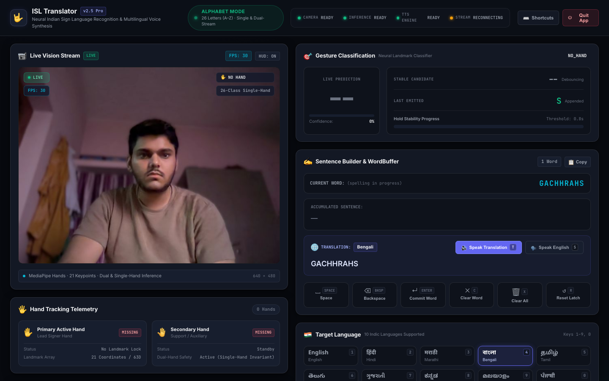
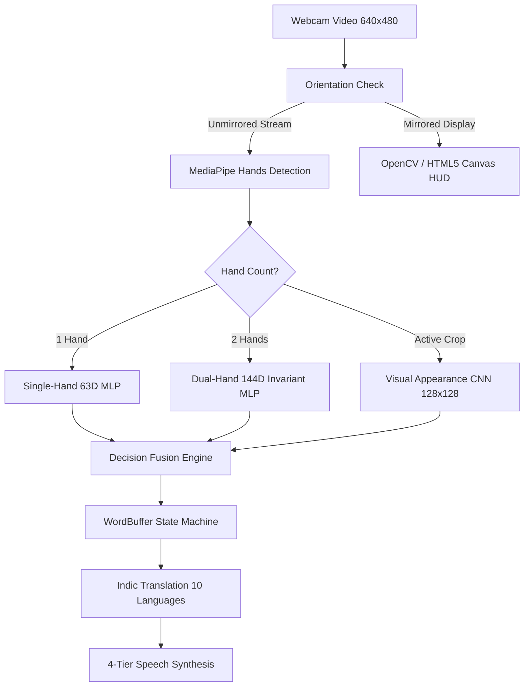

# Real-Time Indian Sign Language Recognition & Translation

[](tests/)
[](requirements.txt)
[](LICENSE)

An edge-deployable assistive platform that transcribes live Indian Sign Language (ISL) fingerspelling (A–Z) into text, translates assembled phrases across 10 Indian regional languages, and vocalizes speech through a resilient multi-tier synthesizer.

---

## 📸 Interface Preview



> **Assistive Mission:** Bridging the communication gap for 18M+ deaf and hard-of-hearing individuals across India with accessible, private, on-device computing without recurring cloud fees.

---

## 🎯 Scope: What It Does & Does Not Do

### What It Does
- **26 ISL Letters (A–Z):** Recognizes both single-hand and two-handed bimanual fingerspelling signs locally on consumer hardware.
- **Hand Gating Router:** Dispatches camera frames between single-hand (63D) and dual-hand invariant (144D) geometric MLP classifiers.
- **Multi-Modal Decision Fusion:** Blends skeletal landmark geometry with an appearance CNN (128×128 RGB crop) using confidence-weighted voting.
- **Temporal WordBuffer:** Debounces predictions (1.2 s hold time), rejects spurious hand transitions, and supports hands-free text editing.
- **10-Language Indic Translation:** Sub-millisecond offline dictionary mapping for common phrases into Hindi, Bengali, Tamil, Telugu, Marathi, Gujarati, Kannada, Malayalam, Punjabi, and English (dictionary-based for a limited vocabulary, not reviewed by native speakers). Optional neural IndicTrans2 and Meta MMS-TTS modules are implemented in `src/language_services/` (not on default camera path).
- **4-Tier Speech Synthesis:** Auditory feedback using macOS `say` $\to$ `pyttsx3` $\to$ `gTTS` $\to$ Browser Web Speech API. Optional Meta MMS-TTS neural speech synthesis is implemented in `src/language_services/`.
- **Cross-Platform Delivery:** Runs as a responsive browser interface (Flask + SSE) or a standalone macOS desktop application (`ISL Translator.app`).

### What It Does NOT Do
- **Not Continuous Sign Language Translation:** Focuses strictly on static/fingerspelling alphabet gestures, not continuous signing with grammatical facial expressions.
- **No Dynamic MoP-GRU in Live Pipeline:** The upstream whole-word MoP-GRU model is archived in `legacy/` as reference code, not active in the live alphabet loop.
- **Live Multi-Signer Accuracy Pending:** All reported benchmark metrics are measured on same-signer held-out splits. Live generalization across diverse signers remains pending.
- **Untested Non-macOS Hardware:** Camera ingestion and audio synthesis paths on Windows and Linux are implemented but untested on real physical hardware.

---

## 📊 Benchmark & Diagnostic Summary

All metrics are measured on same-signer held-out test splits (see [docs/RESULTS.md](file:///Users/aroitsehrawat2030/Downloads/Indian-Sign-Language-Recognition/docs/RESULTS.md) for full audit data):

| Subsystem / Model | Architecture | Held-Out Test Set | Top-1 Accuracy | Macro F1 | Status & Notes |
| :--- | :--- | :---: | :---: | :---: | :--- |
| **Dual-Hand Geometry** | 144D Invariant MLP | $N=243$ (same-signer) | **78.19%** | 0.7349 | Clean baseline (unmirrored inputs) |
| **Visual Appearance** | 128×128 RGB CNN | $N=243$ (paired crops) | **82.72%** | 0.7565 | Appearance branch on same-signer photos |
| **Decision Fusion** | Clean Fused (Geom + CNN) | $N=243$ (paired) | **78.19%** | 0.7349 | Matches best geometry branch offline |
| **K/T Heuristic Override** | Post-hoc geometric gate | $N=243$ | 83.13% | 0.7834 | *Possibly tuned on test data; not a clean estimate* |
| **Camera Mirror Parity** | `model_input_unmirrored` | $N=243$ | 78.19% vs 29.22% | — | Fixed selfie inversion (-48.97% drop on held-out landmarks) |
| **Hand Hysteresis** | 2-frame temporal buffer | Synthetic 50-frame | 85.7% flicker drop | — | Prevents flapping during occlusion (synthetic test) |

> [!NOTE]
> Offline rankings on same-signer photos do not predict live multi-signer performance. Formal multi-signer benchmarking is scheduled for future work.

---

## 🛠️ How It Works



---

## ⚙️ Core Subsystem Capabilities

1. **Perception & Geometric Invariance (`src/inference_engine.py`, `src/mediapipe_utils.py`):**
   - Extracts 21 3D landmarks per hand using Google MediaPipe Hands.
   - Calculates scale-invariant coordinates normalized by wrist-to-MCP distance.
   - Automatically sorts bilateral hands (left/right) to eliminate operator positioning drift.

2. **Temporal WordBuffer State Machine (`src/alphabet_engine.py`):**
   - Applies a 1.2 s stability confirmation threshold before emitting a recognized character.
   - 2-frame hysteresis buffer prevents hand-count flapping during occlusion signs (B, D, P).
   - Provides hands-free word assembly, space injection, backspace deletion, and buffer reset.

3. **Multilingual Translation & Multi-Tier Audio (`src/translator.py`, `src/tts_engine.py`):**
   - Sub-5 ms instant dictionary translation for common greeting and emergency phrases (dictionary-based translations for a limited vocabulary, not reviewed by native speakers).
   - Resilient speech synthesis chain: macOS native `say` $\to$ `pyttsx3` $\to$ `gTTS` $\to$ Web Speech API.
   - Optional neural modules (`IndicTrans2` ONNX and Meta `MMS-TTS`) are implemented in `src/language_services/` (not on default real-time camera path), with benchmarks reported in `tests/benchmark_languages.py`.

---

## 🚀 Quick Start

### macOS (Tested & Recommended)
```bash
# 1. Clone the repository
git clone https://github.com/TechnoDream956/indian-sign-language-recognition.git
cd indian-sign-language-recognition

# 2. Configure Python 3.10 virtual environment
python3.10 -m venv venv
source venv/bin/activate
pip install -r requirements.txt

# 3. Launch application server (Port 5001)
./run_app.sh
# Alternatively: double-click "ISL Translator.app" or "Launch ISL Translator.command"
```

### Windows & Linux (Untested on Real Hardware)
```bash
# 1. Configure virtual environment
python -m venv venv
# Windows: venv\Scripts\activate | Linux: source venv/bin/activate
pip install -r requirements.txt

# 2. Launch development server
python src/app.py
```
Open your web browser and navigate to `http://127.0.0.1:5001`.

---

## 🔧 Key Configuration & Troubleshooting

| Parameter / Issue | Default / Behavior | Description & Solution |
| :--- | :---: | :--- |
| `model_input_unmirrored` | `True` | Passes unmirrored coordinates to models while preserving mirrored UI preview. |
| `single_instance_port` | `5001` | Avoids conflict with macOS AirPlay Receiver which binds Port 5000. |
| `cooldown_seconds` | `1.2` | Minimum duration required before emitting the next confirmed character. |
| **macOS Camera Permission** | Blocked | Grant camera access in `System Settings > Privacy & Security > Camera`. |
| **Missing Audio Output** | Silent | Confirm audio output device; on Linux install `espeak` and `libasound2-dev`. |

---

## 🧪 Testing & Verification

The repository maintains an automated test suite verifying model loading, geometric transformations, temporal debouncing, multilingual translation, and API routes:

```bash
# Execute the full automated regression suite
./venv/bin/python -m unittest discover -s tests -p "test_*.py"
```
**Current Test Status:** `Ran 245 tests in 23.7s — OK (100% Passing)`. Full test details: [docs/TESTING.md](file:///Users/aroitsehrawat2030/Downloads/Indian-Sign-Language-Recognition/docs/TESTING.md).

---

## 📂 Repository Structure

```text
├── ISL Translator.app/          # Double-clickable macOS application bundle
├── Launch ISL Translator.command# Double-clickable macOS terminal launcher
├── run_app.sh                   # Local development server launcher
├── Dockerfile                   # Container build configuration
├── assets/                      # Diagrams and figures referenced by docs
├── docs/                        # Complete technical documentation & audits
│   ├── API.md                   # RESTful & SSE API endpoint specifications
│   ├── ARCHITECTURE.md          # Modular architectural specifications
│   ├── DIAGNOSIS.md             # Engineering diagnosis & failure forensics
│   ├── RESULTS.md               # Empirical benchmark & ablation tables
│   ├── INSTALLATION.md          # Multi-platform deployment instructions
│   └── report/                  # Bennett academic project report (.docx & .pdf)
├── legacy/                      # Upstream MoP-GRU word model reference scripts
├── models/                      # Production Keras model checkpoints (.h5)
├── packaging/                   # Build scripts & PyInstaller specs
├── scripts/                     # Master report builder & diagram generators
├── src/                         # Production application source code
├── tests/                       # Automated test suite (245 unit & regression tests)
└── tools/                       # Dataset audit & live collection utilities
```

---

## 👥 Project Team & Academic Credits

**Institution:** School of Computer Science Engineering & Technology (CSET), Bennett University  
**Faculty Mentor:** Dr. Reshu Chaudhary  
**Academic Session:** 2025–2026  

| Team Member | Enrollment Number | Core Project Responsibility |
| :--- | :---: | :--- |
| **Arpit Sehrawat** | `E22CSEU1001` | Architecture, Multi-Modal Decision Fusion & Evaluation Suite |
| **Sachin Sharma** | `E22CSEU1002` | MediaPipe Perception, 144D Dual-Hand Feature Engineering & Hysteresis |
| **Abhu Rai** | `E22CSEU1003` | 10-Language Indic Translation, Dictionary Engine & Multi-Tier TTS |
| **Yash Upadhyay** | `E22CSEU1004` | Desktop UI, macOS App Packaging (`ISL Translator.app`) & Docker |

---

## 📜 Upstream Attribution & License

- **Upstream Work:** This repository originated as a research fork of the MoP-GRU dynamic word recognition project by Barathi Subramanian et al. (2022). The original GRU sequence scripts and training utilities are preserved in `legacy/` under their original MIT License terms.
- **License:** Licensed under the [MIT License](LICENSE). Copyright (c) 2022 Barathi Subramanian. All extensions, fixes, and documentation Copyright (c) 2025–2026 the Project Contributors.
