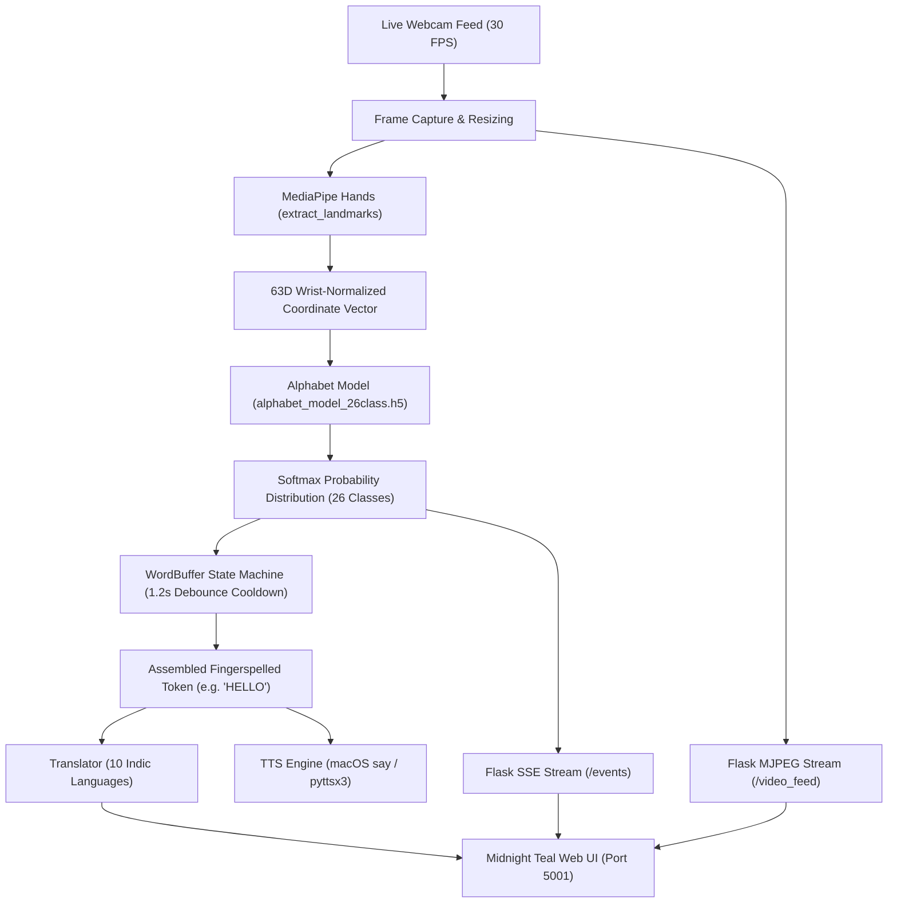

# Indian Sign Language Recognition — Codebase Architecture & Technical Guide

**Audience:** Developers, Students, Reviewers, and Viva Examiners  
**Purpose:** Comprehensive, beginner-friendly explanation of every directory, core Python script, class, and data pipeline in the repository.

---

## 1. High-Level System Overview

The Indian Sign Language (ISL) Recognition and Translation system is organized into modular pipelines:
1. **Perception Pipeline (`src/mediapipe_utils.py`, `src/inference_engine.py`):** Captures live camera frames, detects hands using Google MediaPipe, and extracts wrist-normalized 3D spatial coordinates.
2. **Inference Pipeline (`src/alphabet_engine.py`):** Evaluates landmark vectors using neural network classifiers and filters predictions through an intelligent stateful debounce buffer.
3. **NLP & Audio Pipeline (`src/translator.py`, `src/tts_engine.py`):** Translates completed words/sentences into 10 Indic languages and generates spoken audio using native speech synthesis.
4. **Presentation & Server Pipeline (`src/app.py`, `src/static/`, `src/templates/`):** Hosts a multi-threaded Flask web server, serves an annotated video stream (MJPEG), pushes sub-50ms telemetry via Server-Sent Events (SSE), and renders an accessible Midnight Teal workspace UI.
5. **Packaging Pipeline (`packaging/`):** Wraps the entire ecosystem into a double-clickable native macOS `.app` bundle.



---

## 2. Directory Structure & Organization

```text
Indian-Sign-Language-Recognition/
├── assets/                          # System diagrams and visual previews
├── data/                            # Datasets, manifests, and archives
│   ├── archive/                     # Quarantined & historical legacy datasets
│   ├── combined_alphabet/           # Partitioned baseline datasets
│   ├── external_dataset_work/       # Multi-signer sessions & experimental partitions
│   ├── manifests/                   # Dataset audit manifests and hash records
│   ├── normalized/                  # Wrist-normalized benchmark arrays
│   ├── phase5p_dual_hand/           # Dual-hand collection runs
│   ├── quarantine/                  # Quarantined invalid data (Ayesha pixel arrays)
│   ├── staging_downloads/           # Raw source archives (RealSign, OpenHands)
│   └── staging_extracted/           # Extracted pose landmarks
├── dist/                            # Production distribution bundles
│   └── ISL Translator.app           # Native double-clickable macOS desktop bundle
├── docs/                            # Comprehensive documentation suite
│   ├── reports/                     # Historical research & engineering reports (Phases 1-5C.3)
│   ├── ARCHITECTURE.md              # Formal system architecture specifications
│   ├── CODEBASE_GUIDE.md            # This beginner-friendly technical guide
│   ├── DATASETS.md                  # Dataset schemas, licensing, and provenance
│   ├── INSTALLATION.md              # Step-by-step setup and environment guide
│   ├── PRESENTATION_GUIDE.md        # University presentation and viva preparation guide
│   └── USER_GUIDE.md                # Gesture guides and keyboard shortcuts
├── models/                          # Neural network models and label mappings
│   ├── alphabet_label_map.json      # 26-class alphabet mapping (0: 'A', ..., 25: 'Z')
│   ├── alphabet_model_26class.h5    # Production 63D single-hand model
│   ├── experimental/                # Research models (Two-Stream 129D, Aperture 132D)
│   └── retired_word_models/         # Decommissioned MoP-GRU word sequence models
├── packaging/                       # Desktop packaging and launch automation
│   ├── ISL_Translator.spec          # PyInstaller build specification
│   ├── build_app.sh                 # Packaging build automation script
│   ├── launcher.py                  # Python single-instance lifecycle runner
│   └── mac_app_launcher.sh          # Relative-path executable for .app bundle
├── src/                             # Core Python application modules
│   ├── static/                      # Frontend assets (style.css, app.js)
│   ├── templates/                   # Frontend HTML templates (index.html)
│   ├── alphabet_engine.py           # 26-class inference and WordBuffer state machine
│   ├── app.py                       # Flask server, REST API, SSE, MJPEG streaming
│   ├── inference_engine.py          # Camera loop, MediaPipe worker thread
│   ├── mediapipe_utils.py           # Landmark extraction & coordinate normalization
│   ├── translator.py                # 10 Indic languages neural machine translation
│   └── tts_engine.py                # Low-latency speech synthesizer (macOS say / pyttsx3)
├── tests/                           # 153 automated regression and unit tests
│   ├── test_alphabet_engine.py      # Tests for inference and WordBuffer debounce
│   ├── test_alphabet_translation.py # Tests for Indic translation and TTS dispatching
│   ├── test_phase5b1_features.py    # Tests for thumb-index aperture feature extractors
│   └── test_phase5c_temporal.py     # Tests for temporal acquisition and quota locks
├── .gitignore                       # Clean Git exclusion rules
├── LICENSE                          # MIT License
├── README.md                        # Master repository documentation
├── requirements.txt                 # Pinned Python package dependencies
└── THIRD_PARTY_NOTICES.md           # Attribution notices for open-source libraries
```

---

## 3. Core Python Modules Walkthrough

### 3.1 `src/mediapipe_utils.py` — Perception & Normalization
**What it does:** Interfaces with Google MediaPipe Hands to convert raw camera pixels into clean, mathematically invariant numerical coordinates.
- **Key Functions:**
  - `mediapipe_detection(image, model)`: Converts OpenCV BGR frames to RGB, flags frames as non-writeable for speed, executes `model.process()`, and converts back to BGR.
  - `extract_landmarks(results)`: Extracts 21 3D hand landmarks ($x, y, z$). If no hand is detected, returns an all-zero 63-dimensional array (`np.zeros(63)`).
  - `normalize_landmarks(landmarks)`: Critical invariant normalization step. Subtracts the wrist joint coordinate (Landmark 0) from all 21 landmarks ($\mathbf{P}_i' = \mathbf{P}_i - \mathbf{P}_0$). This ensures the model classifies hand posture independently of where the hand is positioned inside the camera frame.
  - `draw_styled_landmarks(image, results)`: Draws high-visibility skeletal lines and joint dots on the video frame for HUD feedback.
- **Input:** Raw BGR image frame (NumPy array, shape $(480, 640, 3)$).
- **Output:** Normalized 63D feature vector (NumPy array, shape $(63,)$).

---

### 3.2 `src/alphabet_engine.py` — Classifier & WordBuffer State Machine
**What it does:** Hosts the Keras neural network model, executes forward passes, and implements the **WordBuffer State Machine** that turns steady sign postures into assembled words.
- **Key Class: `AlphabetEngine`:**
  - `load_model(model_path)`: Loads the trained Keras model (`models/alphabet_model_26class.h5`) and label encoder map.
  - `predict(landmarks)`: Runs forward inference on a 63D vector, returns the predicted letter character (e.g., `'A'`), confidence score (0.0 to 1.0), and the complete probability vector.
- **WordBuffer State Machine Logic:**
  - Prevents "stutter typing" (emitting `'AAAA'` when holding sign `'A'`).
  - Implements a **1.2-second debounce cooldown**: After a letter is accepted, the buffer locks against repeating that same letter until the hand changes posture or the timer expires.
  - Provides state control methods:
    - `add_space()`: Inserts a space token (`' '`) separating words.
    - `backspace()`: Deletes the last accepted character.
    - `clear_word()`: Clears the uncommitted current word buffer.
    - `clear_sentence()`: Clears the entire completed sentence buffer.
- **Input:** 63D landmark vector.
- **Output:** Dictionary containing `raw_letter`, `confidence`, `stable_letter`, `emitted_letter`, `current_word`, `sentence`, and `full_text`.

---

### 3.3 `src/inference_engine.py` — Threaded Camera Loop
**What it does:** Coordinates video capture, MediaPipe inference, and state tracking on an independent background daemon thread to keep Flask responsive.
- **Key Class: `InferenceEngine`:**
  - Manages `cv2.VideoCapture(0)` to read camera frames at native frame rates (30 FPS).
  - Encapsulates threading locks (`threading.Lock`) to safely share the latest processed frame and telemetry dictionary between the camera thread and Flask web clients.
  - Generates the MJPEG byte stream (`generate_frames()`) consumed by `/video_feed`.
  - Releases camera hardware and MediaPipe instances cleanly on shutdown.
- **Input:** Hardware webcam stream (`cv2.VideoCapture`).
- **Output:** Annotated video frames (JPEG bytes) and real-time telemetry dictionaries.

---

### 3.4 `src/translator.py` — Multilingual Translation
**What it does:** Translates English fingerspelled text into 10 regional Indian languages using neural translation services.
- **Supported Languages:**
  - Hindi (`hi`), Tamil (`ta`), Telugu (`te`), Marathi (`mr`), Bengali (`bn`), Gujarati (`gu`), Kannada (`kn`), Malayalam (`ml`), Punjabi (`pa`), Urdu (`ur`), and English (`en`).
- **Key Function: `translate_text(text, target_language)`:**
  - Sanitizes input tokens and checks language mapping dictionary.
  - Performs neural machine translation via `googletrans.Translator`.
  - Implements offline safe fallback: If internet is unreachable, returns the English text with an `[Offline]` status rather than crashing.
- **Input:** English string (e.g., `"HELLO"`), Target language code (e.g., `"hi"`).
- **Output:** Translated Unicode string (e.g., `"नमस्ते"`).

---

### 3.5 `src/tts_engine.py` — Low-Latency Speech Synthesizer
**What it does:** Converts recognized or translated text into audible spoken speech without blocking the web application.
- **Multi-Backend Architecture:**
  - **Backend 1 (macOS Native `say`):** Uses native macOS text-to-speech subprocesses for sub-50ms synthesis latency. Automatically selects regional voices:
    - Hindi / Marathi: Voice `Lekha` (`say -v Lekha`)
    - Indian English: Voice `Rishi` (`say -v Rishi`)
  - **Backend 2 (`pyttsx3`):** Offline cross-platform fallback for Windows/Linux.
  - **Backend 3 (`gTTS`):** Google Cloud Text-to-Speech fallback.
- **Key Features:**
  - **Busy Gating & Non-Blocking Worker Thread:** Queues speech requests so rapid sign emissions do not overlap or glitch audio playback.
  - Exposes `/api/tts/voices` endpoint so the frontend UI can list available system voices.
- **Input:** Text string, language code.
- **Output:** Audio playback via system speakers.

---

### 3.6 `src/app.py` — Flask Web Server & API Gateway
**What it does:** The central controller serving HTML/CSS/JS frontend files, broadcasting Server-Sent Events, and handling REST API commands.
- **Key Endpoints:**
  - `GET /`: Renders `src/templates/index.html`.
  - `GET /video_feed`: Streams multipart MJPEG JPEG frames for the live video player.
  - `GET /events`: SSE (Server-Sent Events) endpoint pushing JSON telemetry at ~25 FPS (prediction, confidence, WordBuffer status, translation).
  - `POST /api/action/space`: Injects a space character into the WordBuffer.
  - `POST /api/action/backspace`: Deletes the last character from the WordBuffer.
  - `POST /api/action/clear`: Clears the current word buffer.
  - `POST /api/action/clear-sentence`: Clears the entire sentence buffer.
  - `POST /api/action/speak`: Triggers TTS speech synthesis of the current text.
  - `POST /api/translate`: Triggers multilingual translation into the selected language.
  - `POST /api/shutdown`: Initiates idempotent application shutdown, stops the camera, and terminates background threads.

---

### 3.7 `packaging/launcher.py` & `packaging/mac_app_launcher.sh`
**What it does:** Provides the production runtime entrypoint for desktop users.
- `packaging/mac_app_launcher.sh`: The executable located inside `dist/ISL Translator.app/Contents/MacOS/ISL Translator`. Resolves the project root 4 levels up (`MACOS_DIR/../../../..`), checks that `venv/bin/python` exists, and invokes `packaging/launcher.py`.
- `packaging/launcher.py`:
  - **Single-Instance Safety:** Checks if port 5001 is already running via `check_existing_instance()`. If running, activates the existing browser tab and exits immediately to prevent duplicate camera locks.
  - **Asset Verification:** Confirms models, static CSS, and templates exist.
  - **Browser Polling:** Dynamically polls `http://127.0.0.1:5001/api/status` until healthy, then opens the default web browser automatically.
  - **Signal Coordination:** Listens for SIGTERM, SIGINT, SIGHUP to stop the camera and release system resources cleanly.

---

## 4. Experimental Research Modules

The repository also maintains isolated research modules in `src/` and `data/external_dataset_work/`:
- **`src/spatial_feature_extractor.py`:** Extracts 129D and 132D feature representations. Computes relative wrist displacement vectors ($\Delta \mathbf{P}_{\text{wrist}} = \mathbf{P}_{\text{right}} - \mathbf{P}_{\text{left}}$) and thumb-index Euclidean apertures ($\|\mathbf{P}_{\text{thumb}} - \mathbf{P}_{\text{index}}\|$).
- **`src/dataset_intelligence.py`:** Dataset auditing tool that verifies sample counts, deduplicates frames via SHA-256 hashes, and constructs leak-free splits.
- **`src/collect_dual_hand_alphabet.py`:** Automated hands-free data collection suite for recording bimanual sign sequences with stability gating and automated class advancement.

---

## 5. Summary of Dependencies (`requirements.txt`)

| Package | Version | Purpose in Codebase |
|---|---|---|
| `tensorflow` | 2.15.x | Neural network model loading, forward inference, Keras layers |
| `mediapipe` | 0.10.9 | High-performance 3D hand and landmark detection |
| `opencv-python` | 4.8.x | Camera capture, frame transformations, HUD drawing |
| `flask` | 3.0.x | Web server, MJPEG streaming, SSE event broadcasting, REST API |
| `numpy` | 1.26.x | Vector transformations, coordinate arithmetic, normalization |
| `scikit-learn`| 1.3.x | Metrics computation, class weighting, LabelEncoder deserialization |
| `googletrans` | 3.1.0a0| Neural machine translation into 10 Indic languages |
| `pyttsx3` | 2.90 | Offline cross-platform text-to-speech engine fallback |
| `gTTS` | 2.4.x | Cloud-based text-to-speech fallback |
| `pyinstaller` | 6.4.x | macOS desktop `.app` bundle compilation |

