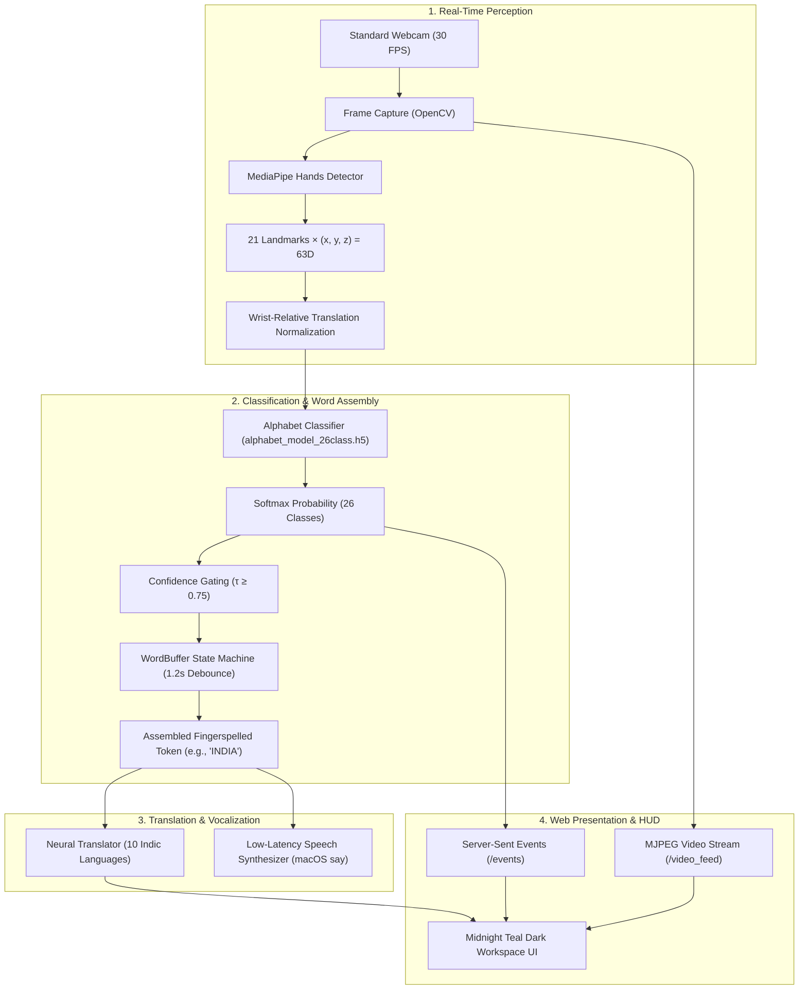

# Indian Sign Language Recognition — University Presentation & Viva Examination Guide

**Project:** Indian Sign Language (ISL) Recognition, Fingerspelling Composition & Multilingual Translation System  
**Prepared For:** University Academic Defense, Capstone Review, and Technical Viva Voce  

---

## 1. Executive Summary & Problem Statement

### The Problem
Over **18 million deaf and hard-of-hearing individuals** in India use Indian Sign Language (ISL) as their primary mode of communication. However, a severe shortage of certified ISL interpreters creates an immense communication barrier in education, healthcare, legal services, and public administration. Existing commercial vision solutions often rely on computationally prohibitive deep convolutional networks processing raw video pixels, making edge deployment on standard consumer laptops difficult without discrete GPUs.

### The Solution
This project presents an **end-to-end, edge-deployable, real-time ISL recognition and translation system**. It uses **Google MediaPipe** to extract 3D skeletal landmarks from an ordinary 30 FPS webcam feed, normalizes them for translation invariance, classifies gestures via neural networks, manages sentence composition through a stateful debounce machine, translates the resulting text into **10 regional Indian languages**, and vocalizes translations with native low-latency speech synthesis.

---

## 2. System Architecture & Complete Pipeline

---

## 3. Technology Stack Choices & Defense Rationales

During your viva, examiners frequently ask **"Why did you choose X instead of Y?"** Here are the precise technical rationales:

| Decision Point | Technology Chosen | Alternatives Considered | Technical Rationale for Choice |
|---|---|---|---|
| **Perception Framework** | **Google MediaPipe Hands** | Raw CNNs (ResNet, YOLO, VGG) | CNNs on raw video require high compute (discrete GPUs), are sensitive to background clutter/skin-tone variations, and suffer from high latency. MediaPipe extracts 3D skeletal coordinates at 30+ FPS directly on consumer CPUs with zero GPU dependency. |
| **Feature Representation** | **Wrist-Normalized Coordinates** | Absolute Pixel Coordinates | Raw pixel coordinates change whenever the user moves relative to the camera. By subtracting the wrist coordinates ($\mathbf{P}_i' = \mathbf{P}_i - \mathbf{P}_0$), the feature vector becomes **translation-invariant**, so the sign is recognized identically whether performed in the center, left, or right of the frame. |
| **Asynchronous Streaming** | **Server-Sent Events (SSE)** | WebSockets / HTTP Polling | HTTP polling creates unacceptable latency and network overhead. WebSockets require full-duplex protocol negotiation. SSE is unidirectional (server-to-client), operates natively over standard HTTP/1.1, auto-reconnects, and delivers sub-50ms telemetry with minimal server overhead. |
| **Speech Synthesis (TTS)** | **macOS Native `say` Subprocess** | Cloud TTS (Google TTS API) | Cloud TTS APIs require an active network call per word/sentence, introducing 300–800ms latency. The native macOS `say` engine executes offline with sub-50ms latency and supports authentic Indic voice models (`Lekha` for Hindi/Marathi, `Rishi` for Indian English). Cross-platform `pyttsx3` is maintained as a fallback. |
| **Frontend Aesthetic** | **Midnight Teal Workspace UI** | Generic Bootstrap / Material | Accessibility-focused dark palette (`#101820` background, `#35c6b0` teal accent) designed specifically for vision workstations: reduces eye fatigue during extended signing sessions and maximizes visual contrast for landmark skeleton overlays and confidence HUD meters. |

---

## 4. Understanding Model Tiers (Critical Viva Distinction)

> [!IMPORTANT]
> **Examiners will look for honesty and rigor.** Clearly explain that the project maintains a **production baseline** and **experimental research pipelines**:

### 1. Active Production System (Single-Hand 26-Class Baseline)
- **Model Checkpoint:** `models/alphabet_model_26class.h5`
- **Architecture:** 4-layer Sequential Feedforward MLP (Input 63D $\to$ Dense 128 $\to$ Dense 64 $\to$ Dense 32 $\to$ Softmax 26).
- **Features:** 63 wrist-normalized coordinates ($21 \text{ landmarks} \times 3 \text{ dimensions}$).
- **Role:** Drives the live application, web dashboard, and macOS desktop app.
- **Performance:** **73.72%** Top-1 Accuracy, **85.89%** Top-3 Accuracy, **89.46%** Accepted Accuracy when confidence exceeds $\tau \ge 0.75$.

### 2. Experimental Research System (Dual-Hand Spatial & Aperture Models)
- **Phase 5A Two-Stream Model (`Exp_C_TwoStream_NoSpatialAug_seed42.h5`):**
  - Uses 129D features: 126D hand shapes + 3D relative wrist displacement vector ($\Delta \mathbf{P}_{\text{wrist}} = \mathbf{P}_{\text{right}} - \mathbf{P}_{\text{left}}$).
  - Decouples shape from spatial height via two parallel dense streams. Achieved **89.21%** validation accuracy and resolved the RealSign letter Q collapse ($p < 0.001$, McNemar test).
- **Phase 5B.1 Aperture Model (`Exp_C_Aperture132D_seed42.h5`):**
  - Uses 132D features: 129D Two-Stream + 3D thumb-index Euclidean aperture distances.
  - Achieved **90.09%** validation accuracy and resolved the $Q \leftrightarrow B$ collision (Letter Q F1 jumped from 0.0% to 90.9%; Letter B precision reached 100.0%).
- **Phase 5C Proposed Temporal BiGRU:**
  - Designed for 15 dynamic/confusable signs using a 30-frame temporal motion window ($30 \times 42\text{D}$). The acquisition protocol is prepared (Signer 03 partitioned, Signer 04 planned), but the model is **untrained** and not in production.

---

## 5. Slide-by-Slide Presentation Outline

- **Slide 1: Title & Team:** Project Title, Department, Team Members, Supervisor, Academic Year.
- **Slide 2: Motivation & Background:** Communication barrier in ISL, interpreter scarcity, limitations of existing pixel-based deep learning models.
- **Slide 3: Proposed Architecture:** End-to-end pipeline diagram from camera input to MediaPipe 3D coordinates, neural classifier, WordBuffer, and multilingual voice output.
- **Slide 4: Perception & Coordinate Invariance:** Why MediaPipe Hands was chosen; mathematical explanation of wrist-relative landmark normalization ($\mathbf{P}_i - \mathbf{P}_0$).
- **Slide 5: Neural Classification & WordBuffer State Machine:** Explanation of the 26-class Dense model; the 1.2-second debounce cooldown preventing stutter-typing; space, backspace, and clear operations.
- **Slide 6: Multilingual Translation & Voice Synthesis:** Supporting 10 Indic languages; sub-50ms native macOS `say` voice routing (`Lekha`, `Rishi`); offline fallbacks.
- **Slide 7: Experimental Research: Two-Stream & Aperture Breakthroughs:** Resolving spatial confounding in two-handed signs (Letters Q and B); Two-Stream 129D and Aperture 132D architectures; McNemar statistical significance.
- **Slide 8: User Interface & Packaging:** Live preview of the Midnight Teal accessibility UI; Server-Sent Events architecture; native macOS double-clickable `.app` bundle.
- **Slide 9: Experimental Results & Testing:** 153 automated tests passing; confusion matrices; Top-1, Top-3, and confidence-gated accuracy metrics.
- **Slide 10: Limitations & Future Work:** Ambient lighting sensitivity; bimanual occlusion; transition from static fingerspelling to multi-signer temporal BiGRU continuous signing.

---

## 6. Comprehensive Viva Voce Questions & Model Answers

### Q1: Why didn't you train a Convolutional Neural Network (CNN) directly on the camera frames?
> **Model Answer:** "Training a CNN on raw pixels requires massive image datasets, high computational power (GPU), and makes the model highly vulnerable to variations in background clutter, skin tone, clothing, and room lighting. By using Google MediaPipe Hands as a perceptual front-end, we extract the skeletal geometry (21 3D landmarks) directly on the CPU at 30 FPS. Our downstream neural network trains on compact, low-dimensional coordinate vectors rather than millions of pixels. This makes the system lightweight, privacy-preserving, and easily executable on standard laptops without a GPU."

### Q2: What is landmark normalization and why is it essential?
> **Model Answer:** "If we feed raw camera coordinates into the classifier, the model learns where the hand is located in the camera frame rather than the shape of the sign. To achieve translation invariance, we perform wrist-relative normalization: for every landmark $i \in \{0, \dots, 20\}$, we compute $\mathbf{P}_i' = \mathbf{P}_i - \mathbf{P}_{\text{wrist}}$. This anchors the wrist at $(0, 0, 0)$ and ensures that whether the user signs on the left, right, top, or bottom of the screen, the feature vector representing the sign posture remains identical."

### Q3: How does your system prevent a held sign from producing repeated letters like 'AAAA'?
> **Model Answer:** "We developed a stateful WordBuffer state machine in `src/alphabet_engine.py`. When a valid sign is predicted with confidence exceeding the threshold ($\tau \ge 0.75$), the character is emitted into the buffer, and a **1.2-second debounce timer** is engaged. While the timer is active, identical predictions are suppressed. The buffer only accepts a new character if the user changes their hand posture to another sign or if the cooldown period expires. We also provide keyboard and UI controls for backspace, space insertion, and buffer clearing."

### Q4: What is the difference between single-hand and two-hand ISL alphabet signs?
> **Model Answer:** "In Indian Sign Language, letters **C, L, O, U, and V** are inherently single-handed. Letters such as **A, B, D, E, F, G, H, I, J, K, M, N, P, Q, R, S, T, W, X, Y, and Z** are bimanual (two-handed). In our production system, single-hand signs are classified by our 63D baseline model. In our experimental research track (Phase 5A and 5B.1), we developed Two-Stream architectures that extract both hands (126D) along with the relative displacement between wrists (3D) and finger aperture distances (3D) to accurately distinguish complex bimanual interactions."

### Q5: How did you solve the confusion between Letter Q and Letter B in your research?
> **Model Answer:** "In Phase 4, our flat 129D spatial model suffered from a collapse where letter Q was frequently misclassified as letter B. In RealSign, signers held their wrists at varying elevations, causing the model to overfit on raw wrist height. In Phase 5A, we decoupled hand shape from spatial elevation using a Two-Stream architecture. Then, in Phase 5B.1, we introduced **Thumb-Index Aperture features** ($\mathbf{F}_{\text{aperture}} = \|\mathbf{P}_{\text{thumb\_tip}} - \mathbf{P}_{\text{index\_tip}}\|$). Because letter Q involves pinching the thumb and index finger while letter B keeps the fingers open and flat, adding this 3D distance feature lifted Letter Q F1 from 0.0% to 90.9% and eliminated false positives for Letter B."

### Q6: Why did you use Server-Sent Events (SSE) instead of WebSockets?
> **Model Answer:** "Sign language recognition is a unidirectional streaming problem: the backend continuously pushes telemetry (detected character, confidence, word buffer, and translation) to the browser. Server-Sent Events (SSE) run over standard HTTP, require no special WebSocket handshake or upgrade headers, handle automatic reconnections natively in the browser's `EventSource` API, and incur significantly lower memory overhead on the Flask server."

### Q7: What are the current limitations of the system?
> **Model Answer:** "The primary limitations are:
> 1. **Lighting Sensitivity:** MediaPipe requires adequate ambient lighting; extreme darkness or harsh backlighting causes landmark jitter.
> 2. **Hand Occlusion:** When one hand completely covers the other in complex bimanual signs, landmark tracking on the rear hand can degrade.
> 3. **Production Scope:** The live application is currently deployed with the 26-class single-hand model; the 132D bimanual model and temporal BiGRU model are validated research prototypes that represent our immediate path toward continuous multi-signer recognition."

